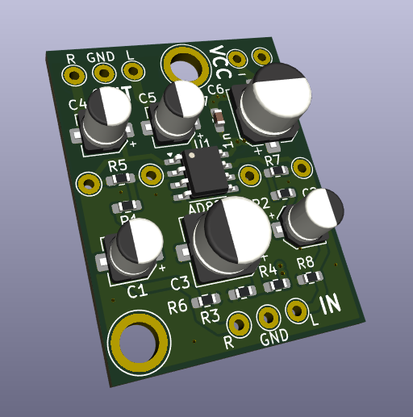

## Documentation for Generic ADA828 Amplifier Boards

These audio amplifier opamp boards are commonly available on sites like Amazon, Alibaba and eBay, but there does not seem to be any schematics for them.

Here is an accurate recreation in KiCAD, including spice simulations and gain resistor settings.

